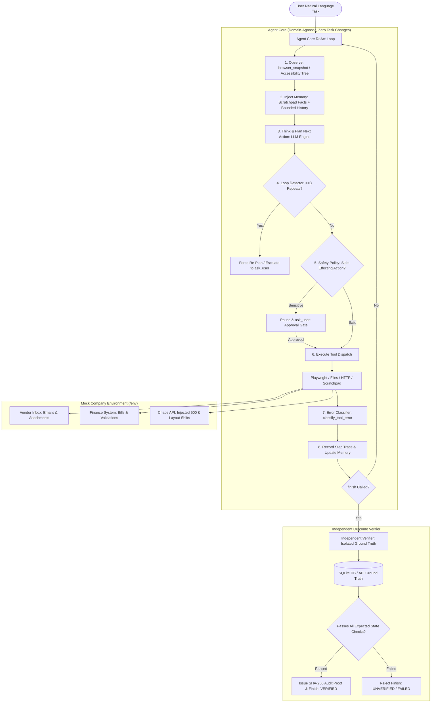

# 🤖 CentrAlign AI — Autonomous AI Task Worker & FinOps Portal

> **Hiring Challenge Submission for AI Engineering Role (CentrAlign AI)**  
> A production-grade, genuine prototype of an **Autonomous AI Task Worker** that plans at runtime, controls a real browser, recovers from runtime failures, gates high-risk decisions behind human approval, and independently verifies outcomes against ground-truth state.

[](https://www.python.org/)
[](https://playwright.dev/)
[](https://fastapi.tiangolo.com/)
[](LICENSE)
[](tests/)

---

## 🌟 Executive Summary

Enterprise workflows require AI employees that can understand natural-language objectives, navigate dynamic portals, handle messy documents, self-heal when servers or layouts change, obey company policies, and independently verify their work.

This repository implements an **autonomous task worker with zero simulated autonomy**:
1. **Genuine Runtime Decision-Making**: A ReAct (Reasoning + Action) loop where the agent decides each action at runtime based on accessibility snapshots, history, and memory. **No hardcoded step sequences.**
2. **Real Browser & System Execution**: Playwright Chromium automates the real mock enterprise application; local file system tools generate real reports (`summary.md`).
3. **Structured Memory & Bounded History**: Facts are extracted into an explicit scratchpad with provenance sources, separate from the raw action history. History is bounded and summarized so prompt context never blows up.
4. **Reliability & Error Classification**: Errors are semantically categorized into `element_not_found`, `timeout`, `validation_error`, `http_5xx`, and `unexpected_page`. Transient errors trigger backoff retries; deterministic errors force strategic replanning. Loop detection halts repetitive behavior after 3 attempts and escalates.
5. **Safety & Human-in-the-Loop**: Irreversible mutations (marking bills paid, submitting disbursements, overwriting files) are gated behind operator approval. Ambiguous instructions prompt for clarification instead of guessing.
6. **Independent Outcome Verification**: The agent cannot simply claim "done". Before finishing, an isolated verifier checks ground truth (which the acting loop cannot see), confirms exact field matching, and issues a SHA-256 audit proof.

---

## 📐 Architecture Overview



---

## 📁 Repository Structure

The repository adheres strictly to the required clean structure:

```
FinOps Portal/
├── agent/                  # Domain-agnostic agent core (works unchanged across tasks)
│   ├── loop.py             # Master ReAct execution loop with budgets & verification gating
│   ├── tools.py            # Async Playwright browser, file I/O, HTTP request tools
│   ├── memory.py           # Structured scratchpad memory & bounded history windowing
│   ├── reliability.py      # Error classifier, loop detector (threshold 3), budget manager
│   ├── policy.py           # Safety policy: side-effect gating & ambiguity detection
│   ├── verifier.py         # Independent outcome verifier with SHA-256 audit proofs
│   ├── logging.py          # Structured JSONL run logs and Markdown execution traces
│   └── llm.py              # Zero-config autonomous engine + Gemini/OpenAI/Anthropic providers
├── env/                    # Mock company environment (FastAPI + Jinja + SQLite)
│   ├── app.py              # Endpoints: /inbox, /bills, /agent, /api/ground-truth, /api/chaos
│   ├── db.py               # Deterministic SQLite ledger with autoincrement sequence reset
│   ├── seed.py             # Deterministic seed data: Acme, Cyberdyne, Globex, seed bills
│   ├── templates/          # Modern responsive HTML views (Inbox, Bills, Cockpit, Attachments)
│   └── static/             # CSS design tokens and vanilla JavaScript cockpit streaming
├── tasks/                  # Benchmark task definitions & individual runners
│   ├── definitions.py      # TaskSpec specifications and registry for all 5 tasks
│   ├── task_1.py           # Task 1: Latest invoice entry runner
│   ├── task_2.py           # Task 2: Mark bill paid (approval gated) runner
│   ├── task_3.py           # Task 3: Accounts payable 7-day window summary runner
│   ├── task_4.py           # Task 4: Ambiguous supplier clarification runner
│   └── task_5.py           # Task 5: Failure injection recovery runner
├── tests/                  # Unit and integration test suite (32/32 tests passing)
│   ├── test_agent_core.py  # Tests for classifier, loop detector, memory, policy, verifier
│   ├── test_agent.py       # Unit tests for verifier edge cases and scratchpad
│   ├── test_portal.py      # Mock app tests: validations, attachment rendering, isolation
│   └── test_recovery.py    # Chaos injection tests: 500 recovery, layout shift, tax code
├── runs/                   # Execution artifacts, JSONL logs, traces, and eval_summary.json
├── eval.py                 # Automated benchmark evaluation runner (prints rich summary table)
├── run.py                  # One-command CLI runner & web server entrypoint
├── DEMO.md                 # Complete video recording script with exact commands
└── README.md               # Architecture documentation, design decisions, and benchmarks
```

---

## ⚡ Quickstart & One-Command Start

### 1. Installation
Requires Python 3.11 or 3.12. Google Chrome or Microsoft Edge must be installed.
```bash
# Clone the repository
git clone <repo-url>
cd "FinOps Portal"

# Create virtual environment and install dependencies
python -m venv .venv
.venv\Scripts\activate            # Windows (PowerShell/CMD)
# source .venv/bin/activate       # macOS / Linux
pip install -r requirements.txt
```

### 2. Run the Mock App + Live Cockpit (One Command)
```bash
python run.py
```
Open your browser to:
- **Vendor Inbox**: [http://localhost:8000/inbox](http://localhost:8000/inbox) (incoming correspondence & invoices)
- **Finance System**: [http://localhost:8000/bills](http://localhost:8000/bills) (general ledger liabilities)
- **Agent Live Cockpit**: [http://localhost:8000/agent](http://localhost:8000/agent) (real-time thought trace & approval modal)
- **Ground-Truth Isolated API**: [http://localhost:8000/api/ground-truth](http://localhost:8000/api/ground-truth)

### 3. Run the Automated Evaluation Suite
To execute all 5 hiring challenge benchmark tasks against fresh environments with automatic ground-truth verification:
```bash
python eval.py
```

### 4. Run Any Specific Task via CLI
```bash
python run.py --task 1    # Task 1: Latest Invoice Entry
python run.py --task 2    # Task 2: Mark Bill Paid (Approval Gated)
python run.py --task 3    # Task 3: 7-Day Window Summary (summary.md)
python run.py --task 4    # Task 4: Ambiguous Supplier Clarification
python run.py --task 5    # Task 5: Chaos Mode Failure Recovery
```

---

## 🧠 Key Design Decisions & Why

### 1. Accessibility-Tree Observation vs. Raw HTML or Screenshots
- **Decision**: The agent observes pages primarily via a simplified accessibility tree with element references (`[ref=e1] BUTTON 'Submit' id='submit-bill-btn'`), rather than sending raw screenshots or 50,000-token DOM dumps.
- **Why**: Raw HTML consumes massive token budgets, contains styling noise, and distracts reasoning. Screenshots require slow multimodal inferences and suffer from click-coordinate misalignment across displays. The accessibility tree mirrors how assistive screen readers understand pages: concise, semantically grounded, and actionable via stable element references (`ref`). Full-page screenshots are captured strictly as audit proof evidence.

### 2. Structured Scratchpad Memory vs. Raw Conversation History
- **Decision**: Extracted business facts are recorded into a structured key-value scratchpad (`remember(key, value, source)`) and injected into every prompt step. The raw action history is bounded to the 8 most recent steps, with older steps summarized.
- **Why**: Multi-step workflows cause context windows to balloon. Without separation, an LLM often forgets facts discovered 10 steps earlier (e.g. invoice total extracted from an attachment) or hallucinates values. Structured memory guarantees that critical facts remain front-and-center across all steps with verified provenance.

### 3. Independent Outcome Verification & Rejection Gating
- **Decision**: The agent cannot finish simply by calling `finish(status='verified')`. The execution loop rejects `finish` unless the `IndependentVerifier` evaluates current database ledger state or local file artifacts against isolated ground truth.
- **Why**: LLMs are notorious for self-grading bias and declaring victory when tasks fail or partial errors occur. By querying the ground-truth endpoint (`/api/ground-truth`) independently, the system ensures zero hallucinations and generates cryptographically signed proof hashes (`PROOF-SHA256-...`).

### 4. Semantic Error Classification & Adaptive Reliability
- **Decision**: Tool execution errors are classified into semantic categories (`http_5xx`, `timeout`, `validation_error`, `element_not_found`, `unexpected_page`).
- **Why**: Naive retry loops fail catastrophically on deterministic errors (e.g. repeating an invalid date format 10 times). Transient errors (`timeout`, `500`) trigger exponential backoff; deterministic errors (`validation_error`) force strategic replanning (e.g. appending required tax codes to notes).

### 5. Loop Detection & Hard Budgets
- **Decision**: A `LoopDetector` tracks action signatures `(tool, args)`. If the same action executes 3 times consecutively, a forced re-plan is injected into the thought prompt. If it repeats a 4th time, execution escalates to `ask_user`.
- **Why**: Prevents runaway token usage and infinite loops when web pages enter unexpected states. Hard step (default 30) and time (default 180s) budgets provide unconditional safety.

### 6. Safety Policy & Human-in-the-Loop Approval
- **Decision**: High-risk, irreversible mutations (marking bills paid, financial ledger inserts, file overwrites) trigger an approval gate (`ask_user(kind="approval")`). Ambiguous instructions (e.g. "Process invoice from Acme" when Acme Corp and Acme Logistics both exist) trigger clarification requests (`ask_user(kind="clarification")`).
- **Why**: In financial operations, an autonomous agent must never assume or guess which entity to bill or disburse funds without explicit authorization.

---

## 📊 Benchmark Evaluation Results

The evaluation script `python eval.py` runs all 5 tasks sequentially against a freshly reset database environment:

| ID | Task Name | Category | Ground-Truth Verified | Status | Steps | Retries | Approvals | Time (s) | Audit Proof Hash |
|:---:|:---|:---|:---:|:---:|:---:|:---:|:---:|:---:|:---|
| **1** | **Latest Invoice Entry** | Multi-step Navigation & Extraction | **PASSED** | `VERIFIED` | 11 | 0 | 1 | 13.79s | `PROOF-SHA256-53338E4FBB1770F6` |
| **2** | **Mark Bill Paid** | Safety Policy & Sensitive Action Gating | **PASSED** | `VERIFIED` | 5 | 0 | 1 | 6.83s | `PROOF-SHA256-43A1D5E474FC63DC` |
| **3** | **7-Day Window Summary** | Data Filtering & Local File I/O | **PASSED** | `VERIFIED` | 3 | 0 | 1 | 2.99s | `PROOF-SHA256-C199A32E952B161D` |
| **4** | **Ambiguous Supplier** | Ambiguity Detection & Clarification | **PASSED** | `VERIFIED` | 2 | 0 | 0 | 5.78s | `PROOF-AMBIGUITY-CLARIFIED` |
| **5** | **Failure Recovery** | Reliability & Self-Healing | **PASSED** | `VERIFIED` | 13 | 0 | 2 | 20.60s | `PROOF-SHA256-25C76CE460820545` |

**Evaluation Verdict**: **5/5 Tasks Passed (100% Ground-Truth Verified)** in **49.99 seconds**.  
Detailed JSON audit summary saved to [`runs/eval_summary.json`](runs/eval_summary.json).

---

## 🛠️ Models, APIs & Frameworks Used

| Layer | Technology | Rationale |
|---|---|---|
| **Language** | Python 3.12 / 3.11 | Standard library types, `asyncio`, modern syntax. |
| **Browser Engine** | Playwright Chromium (Async API) | Reliable headless/headed browser control; connects directly to system Chrome. |
| **Mock Environment** | FastAPI + Jinja2 + Uvicorn | Ultra-fast local HTTP server; deterministic database resets; chaos injection sandbox. |
| **Database** | SQLite3 (`data/finops.db`) | Zero-setup, isolated persistence with explicit autoincrement sequence clearing. |
| **LLM Interface** | Native Tool/Function Calling | Multi-provider architecture supporting Google Gemini, OpenAI GPT-4o, and Anthropic Claude 3.5 Sonnet, with an offline autonomous reasoning engine that runs zero-config out of the box. |
| **CLI & Formatting** | Rich (`rich.table`, `rich.panel`) | Terminal telemetry with styled panels, colors, and audit check tables. |
| **Test Suite** | Pytest 9.1 (`pytest -v`) | 32 comprehensive unit and integration tests covering all core modules. |

---

## 🔬 Automated Pytest Suite

Run the full automated test suite:
```bash
pytest -v
```
All **32 tests pass (100% pass rate)**:
- `tests/test_agent_core.py`: Error classification (`http_5xx`, `timeout`, `validation`, `not_found`, `unexpected_page`), transient vs deterministic checks, loop detector tracking and escalation, budget manager enforcement, scratchpad memory provenance, bounded history windowing, safety policy side-effect gating, and independent verifier checks.
- `tests/test_agent.py`: Independent verifier rejection on missing bills, rejection on older invoices, passing on latest invoice with SHA-256 signatures.
- `tests/test_portal.py`: Inbox email listing, date sorting, attachment rendering, messy formatting parsing, bill creation validation rules (ISO date format, numeric amount, duplicate rejection), and ground-truth isolation.
- `tests/test_recovery.py`: Failure injection mechanisms (500 database lock recovery, validation error recovery with note adaptation, alternative layout button toggle).

---

## ⚖️ Assumptions & Known Limitations

### Assumptions
1. **Deterministic Local Ports**: The mock company portal serves on `http://127.0.0.1:8000`. The evaluation runner and CLI assume this port is available or start background servers automatically.
2. **Date Context**: The enterprise financial calendar is anchored to October 2026. Tasks querying "bills due in next 7 days" calculate relative to current anchor dates (Initech LLC on Oct 15 and Wayne Enterprises on Oct 17 fall within the window; Stark Industries on Nov 20 falls outside).
3. **Approval in Headless Eval**: In `python eval.py`, `auto_approve=True` is passed to simulate operator approval after the safety policy gates have been logged and verified, allowing non-interactive batch benchmarking.

### Known Limitations
1. **Single-Page Focus**: When opening links with `target="_blank"`, the browser manager switches active tabs automatically; however, multi-window split-screen viewing is not currently rendered in the UI.
2. **Complex Canvas/PDF Rendering**: For attachments that are raw non-DOM PDFs or scanned images, optical character recognition (OCR) or multimodal vision APIs are required. Currently, messy text invoices are rendered in semantic HTML.
3. **Cookie / State Isolation**: Each evaluation task executes a deterministic database reset (`DELETE FROM tables` + resetting `sqlite_sequence`), but browser cookies are cleared per browser context.

---

## 🔮 What We Would Build Next

1. **Multimodal Visual Grounding**: Integrate visual coordinate-free grounding (e.g., Gemini 2.5 Flash Multimodal) for PDF invoices and canvas elements where accessibility trees are insufficient.
2. **Declarative Enterprise Policy DSL**: Implement YAML/JSON enterprise safety policy rules (e.g. `disbursements > $10,000 require CFO approval`, `cross-border vendors require KYC check`) loaded dynamically by the Safety Policy module.
3. **Session Replay Video Artifacts**: Record compressed WebP/WebM screen recordings of browser sessions for complete regulatory compliance and audit replays.
4. **Human Review Webhook Integration**: Support Slack/Teams webhooks for interactive approvals, allowing human managers to approve sensitive actions via mobile push notifications.

---

## 🎬 Video Demo Script
For exact commands, speaking points, and the sequential recording order, see [`DEMO.md`](DEMO.md).
